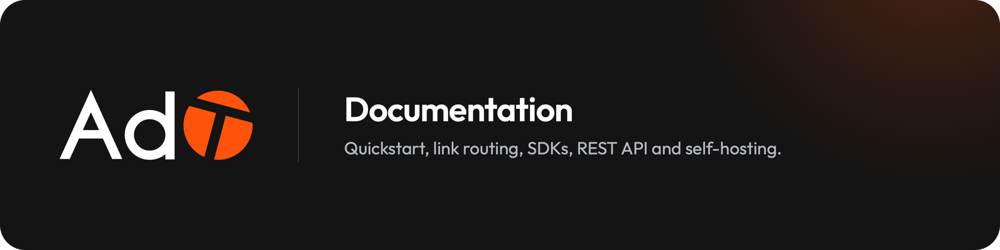

<p align="center">
  <a href="https://adto.app"></a>
</p>

<div align="center">

# AdTo documentation

*The source of [docs.adto.app](https://docs.adto.app)*

[](LICENSE)
[](LICENSE-CONTENT)
[](https://starlight.astro.build)
[](https://render.com/docs/static-sites)

[Working on the docs](#working-on-the-docs) • [Adding a page](#adding-a-page) • [Look and layout](#look-and-layout) • [Conventions](#conventions) • [Deployment](#deployment)

</div>

This repository holds the canonical documentation for [AdTo](https://adto.app), the hosted
deep linking and install attribution service: quickstart, link routing, the Flutter and React
Native SDKs, the dashboard and the REST API. It is built with
[Astro Starlight](https://starlight.astro.build) and served as a static site on Render.

Every page describes what the code does today. Where the product's own wording and the code
disagree, the docs follow the code and say so.

| Repository | Contents |
|---|---|
| `ad-to/adto` | The server, dashboard and website (private) |
| [`ad-to/flutter_adto`](https://github.com/ad-to/flutter_adto) | The Flutter SDK |
| [`ad-to/react-native-adto`](https://github.com/ad-to/react-native-adto) | The React Native and Expo SDK |
| `ad-to/docs` | This site |

## Working on the docs

Node 22.12 or newer (`.nvmrc` says 24).

```bash
npm ci
npm run dev        # http://localhost:4321, live reload
npm run build      # validates internal links, builds the search index, writes dist/
npm run preview    # serves dist/ on http://localhost:4321 (production-like)
```

### Adding a page

1. Create `src/content/docs/<group>/<slug>.md` (or `.mdx` when you need components).
2. Frontmatter:

   ```yaml
   ---
   title: Temporary links
   description: One sentence shown under the title and used in search results and llms.txt.
   sidebar:
     order: 5 # position inside the group
   ---
   ```

3. The sidebar groups are fixed in `astro.config.mjs` (`start`, `links`, `sdk`, `react-native`,
   `dashboard`, `api`, `guides`, `contributing`); pages inside a group are
   picked up automatically and ordered by `sidebar.order`.
4. Link to other pages with absolute paths and a trailing slash: `/api/links/`. Broken internal
   links fail the build.
5. Starlight components (`Steps`, `Tabs`, `Aside`, `Card`) come from
   `@astrojs/starlight/components`.
6. On a step-by-step page, title each step with a `##` heading inside `<Steps>`
   (`1. ## Sign up`). The steps then appear in "On this page".

### Look and layout

The site wears the adto.app identity on top of Starlight:

- `src/styles/custom.css` holds the color, type and size tokens for both themes; `chrome.css`
  styles the header, sidebar, table of contents and footer; `content.css` styles what Markdown
  renders. Code block frames and syntax colors are in `ec.config.mjs`.
- `src/components/` overrides Starlight's header, site title, page title, home page hero, mobile
  menu footer and footer (registered under `components` in `astro.config.mjs`).
  `src/components/home/` holds the sections of the home page, used from
  `src/content/docs/index.mdx`.
- Outfit, Inter and Fira Code are served with the site through the `@fontsource-variable` packages.

### Conventions

- State behaviour, not intentions: numbers, limits, defaults and error strings come from the
  server and SDK source, and the page says which.
- The footer on every page states the versions the docs apply to (`flutter_adto` 1.0.x,
  `react-native-adto` 1.0.x, server migration `0001_schema`). When that changes, bump it in
  `src/components/Footer.astro` and in the `starlightLlmsTxt` `details` in `astro.config.mjs`,
  which feed `llms.txt`.
- `https://docs.adto.app/llms.txt` and `/llms-full.txt` are generated at build time for AI
  agents; `adto.app/SKILL.md` links to them.
- `sdk/api-reference.md` is generated from `flutter_adto/doc/api-reference.md`, which also
  builds the SDK's `llms.txt`. Edit it in the SDK repo, then run `npm run sync:sdk-reference`
  here (`-- --check` reports drift).

## Deployment

docs.adto.app is a [Render](https://render.com) static site built from `main`: `render.yaml`
holds its settings (build command, publish directory `dist/`, the domain). CI
(`.github/workflows/build.yml`) builds every push and pull request and deploys nothing.

docs.dectog.com, the old DecTog docs, stays frozen on Cloudflare at the tag
`docs-dectog-com-final`. Nothing on `main` deploys it; a fix for it is made on a branch from
that tag and deployed from there by hand.
